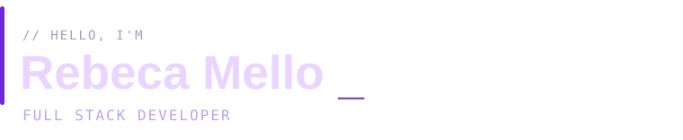

<picture>
  <source media="(prefers-color-scheme: dark)" srcset="./assets/header-dark.svg">
  <source media="(prefers-color-scheme: light)" srcset="./assets/header-light.svg">
  
</picture>

<br>
<br>

```ts
// becamello.config.ts

const beca = {
  name: "Rebeca Mello",
  alias: "@becamello",
  craft: "full stack development",

  likes: [
    "interfaces que fazem sentido",
    "APIs bem resolvidas",
    "código que eu entenda daqui a 6 meses",
  ],

  currently: "building things",
  tabsOpen: "too many",
} as const;

export default beca;
```

<br>

<a id="selected-builds"></a>


<table>
  <tr>
    <td valign="top"><code>01</code></td>
    <td>
      <b><a href="https://github.com/becamello/unCRM">unCRM ↗</a></b><br>
      <sub>VUE.JS &nbsp;·&nbsp; C#/.NET &nbsp;·&nbsp; POSTGRESQL</sub><br><br>
      Um CRM full stack com autenticação JWT, operações CRUD e permissões por perfil.
    </td>
  </tr>
  <tr>
    <td valign="top"><code>02</code></td>
    <td>
      <b><a href="https://github.com/becamello/PEX-MultiAdsConnect">PEX-MultiAdsConnect ↗</a></b><br>
      <sub>C#/.NET &nbsp;·&nbsp; GEMINI API &nbsp;·&nbsp; SWAGGER</sub><br><br>
      Integração com API de IA e documentação de endpoints.
    </td>
  </tr>
</table>

<br>

<a id="toolbox"></a>


```yaml
interface: [Vue.js, JavaScript, TypeScript, Pinia, Vuetify, PrimeVue, Bootstrap]
server:    [C#, .NET, Node.js, REST APIs]
data:      [PostgreSQL, SQL Server, Entity Framework]
workflow:  [Git, Cypress, Vitest, Postman]
```

<br>

<a id="elsewhere"></a>


&nbsp;&nbsp; <a href="mailto:rebecammsilva@outlook.com">email ↗</a> &nbsp;&nbsp;·&nbsp;&nbsp; <a href="https://github.com/becamello?tab=repositories">all repos ↗</a>

<br>

---

<div align="right">
  <sub><code>// made with curiosity, coffee optional.</code></sub>
</div>
